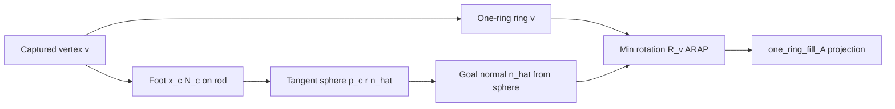

# Dipole Rod Tunneling in Projection Space TDD

## Status

Draft — replacing rod-guided torus-flow / SDF-position hacks with a projection-native
tunneling energy. Legacy paths in [`knotted_surface.hpp`](../include/gaudi/duchamp/modules/knotted_surface.hpp)
are reference only; **tear down and replace**.

**Tests:** [`include/gaudi/test/dipole_tunneling_tests.hpp`](../include/gaudi/test/dipole_tunneling_tests.hpp)

---

## Concept

### Dipole curve / rod

A **dipole curve** is a space curve (rod) with normal field `N(s)` and offset `h`.
At each rod sample `x_r`, define two **whole circles** (full disks) in the plane
spanned by `(B, N)` with `B = N × T`, `T` the rod tangent — **not** half-planes or
half-circles:

```
cen_U = x_r + h · N     upper disk, radius r   →  clearance / negative space (tunnel)
cen_L = x_r − h · N     lower disk, radius r   →  contact / positive space (mesh may sit here)
```

In the local `(B, N)` frame (cf. legacy `cen_U = (0, +h)`, `cen_L = (0, −h)` in
[`init_torus_flow_constraint`](../include/gaudi/duchamp/modules/knotted_surface.hpp)):

```
inside_U  ⇔  |(B·dx, N·dx) − (0, h)| < r
inside_L  ⇔  |(B·dx, N·dx) − (0, −h)| < r     where dx = x − x_r
```

| Disk | Role | Mesh rule |
|------|------|-----------|
| **Upper** (`cen_U`) | Negative / clearance | Mesh must **not** occupy this disk — tunnel through |
| **Lower** (`cen_L`) | Positive / contact | Mesh **may** sit here; shell normal and curve normal should **align** |

Swept along the rod segment, each disk becomes a **sausage** (circle extruded along `T`);
capture queries use the AABB union of the upper and lower sausages.

### Seifert-like surface, but a minimal manifold

Classical Seifert surface: an oriented surface **spanning** a knot with boundary on the curve.

Here we want something analogous but **not** a spanning minimal surface. The target is a
**minimal manifold** (or membrane) that:

- Lives predominantly on / below the dipole rod
- Maintains clearance in the upper disk / sausage (no mesh inside `cen_U` disks)
- Fills coverage gaps along the curve by **tunneling** (projecting mesh into the
  admissible manifold) rather than pulling the mesh along the rod or inflating along
  shell normals with position constraints

### Why prior approaches failed

| Approach | Problem |
|----------|---------|
| Pull mesh along rod | Fights bending/stretch; does not respect dipole disk regions |
| Normal expand/contract SDF + **position** constraint | SDF marching is position-native; collides with projection constraints (ARAP, welds, edge flow) |
| Torus-flow / `edge_normal_flow` in knotted_surface | Post-hoc classification after isotropic edge queries; not a dipole tube gather |

### New approach (projection-native SDF)

For each shell vertex **captured** inside a ± dipole sausage around the rod:

1. **Capture** — segment-wise walk; dual offset tube AABBs (union prefilter); gather verts.
2. **Tangent-point sphere** — foot point `x_c` on curve, normal `N_c`; for vertex `x_v`,
   `r = tangent_point_radius(x_v − x_c, N_c)`.
3. **Sphere center** — `p_c = x_c ± r · N_c` (sign from dipole disk zone).
4. **Per-vertex one-ring rotation** — same mechanism as ARAP, different target geometry
   (see below). **Not** a position constraint on `x_v`.

Where classic SDF inflation pushes along **shell** normal until the implicit field is filled,
this **projects the mesh into the manifold implied by spheres that grow from the curve**.

**Design note:** One-ring rotations compose with stretch/bend/weld projections without the
fighting seen when SDF residuals are enforced as vertex position targets.

---

### Per-vertex one-ring rotation (ARAP-style, sphere target)

**One constraint per captured vertex** — not per edge.

#### ARAP (reference)

Standard ARAP at vertex `i` with one-ring neighbors `j ∈ ring(i)`:

1. Collect rest edge vectors `ē_ij` (or current `q_ij = q_j − q_i`).
2. Find rotation `R_i` minimizing `Σ w_ij | R_i q_ij − p_ij |²` where `p_ij` is the
   **target** offset (perturbed / goal one-ring).
3. Project: each neighbor contributes `R_i q_ij` into the constraint stack via
   `one_ring_fill_A` ([`shell_constraints.hpp`](../include/gaudi/hepworth/block/shell_constraints.hpp)).

The `willmore` constraint uses the same `one_ring_iter` / SVD machinery for a related
normal-based rotation ([`willmore::project`](../include/gaudi/hepworth/block/shell_constraints.hpp)).

#### Tunneling (this work)

Same ARAP machinery; the **sphere replaces the perturbed goal configuration**:

| | ARAP | Dipole tunnel |
|---|------|----------------|
| Target geometry | Perturbed one-ring `p_ij` | Tangent-point sphere `(p_c, r)` |
| Goal | Min-rotation rigid cover of deformed neighbors | Min-rotation one-ring with normal aligned to sphere |
| Per | vertex | vertex |

**Per captured vertex `v` (concrete):**

1. **Foot on curve** — nearest `(x_c, N_c)` on the dipole rod.
2. **Tangent-point sphere** — `r = tangent_point_radius(x_v − x_c, N_c)`;
   `p_c = x_c ± r · N_c` (sign from upper/lower disk zone).
3. **Goal normal from sphere** — tangent-point sphere gives target normal `n̂` at the
   contact (outward sphere normal at the solved tangent point). **No vertex position pin.**
4. **Min rotation + normal alignment (ARAP)** — find `R_v` over the one-ring such that the
   rotated patch matches ARAP rest geometry **and** the rotated vertex normal
   `R_v n_v` aligns with `n̂` (same Procrustes / one-ring machinery as ARAP / `willmore`;
   cf. `willmore::set_align_normal`).
5. **Projection** — `one_ring_iter` + `one_ring_fill_A`: neighbor rows
   `p_j = R_v (q_j − q_i)` (same sparsity as bending). Positions move **through** the
   rotation projection, not through a position residual.

This is a **normal alignment** algorithm on the one-ring, not a position target on `x_v`.
The sphere defines **which normal** the patch should carry; ARAP carries the degrees of
freedom.

**Relation to `point_edge_creep`:** shares `tangent_point_radius` and `p_c`; tunneling
generalizes from one point on the sphere to the full one-ring rotation.



---

## Geometry primitives (to implement)

### Dual sausage capture (per rod segment)

For segment `(x_r0, x_r1)`, frame `(N, T, B)` with `B = N × T`:

```
upper centerline: x_r(t) + h · N
lower centerline: x_r(t) − h · N
each thickened by radius r  →  dual tubes
AABB_query = union(upper_AABB, lower_AABB)   // conservative prefilter
```

Test helpers: `dipole_tunneling::make_dual_tube_aabbs`, `captured_by_dual_tube` in
[`dipole_tunneling_tests.hpp`](../include/gaudi/test/dipole_tunneling_tests.hpp).

### Dual offset disks (whole circles)

Per sample `x_r` on the rod, in frame `(T, B, N)`:

```
cen_U = x_r + h · N
cen_L = x_r − h · N
inside disk  ⇔  distance in (B,N) plane from projected point to cen < r
```

Test: `dipole_dual_disk_whole_circles_at_offset_normals`.

### Tangent-point sphere

```
r = ½ |dp|² / |N Nᵀ dp|
center = x_c + sgn(N · dp) · N · r
```

Test: `dipole_tangent_point_sphere_center` (matches `point_edge_creep` math).

### Per-vertex tunnel constraint (to implement)

Planned class e.g. `dipole_tunnel_one_ring` in hepworth block constraints:

- **Input:** `ids` = one-ring vertex list (`get_one_ring`), `edge_weights`, rod foot
  `(x_c, N_c)`, dipole zone, weight `w`.
- **Rest:** store rest offsets `ē_ij` at build (or from current `x` on first step).
- **project:** SVD for `R_v`; target ring from tangent sphere; `one_ring_iter` → `p`.
- **fill_A:** `one_ring_fill_A` (same sparsity pattern as `bending` / `willmore`).

Reference implementations:
[`one_ring_iter`](../include/gaudi/hepworth/block/shell_constraints.hpp),
[`willmore`](../include/gaudi/hepworth/block/shell_constraints.hpp),
[`shell.get_one_ring`](../include/gaudi/asawa/shell/shell.hpp).

---

## Legacy code (do not extend)

| What | Where | Why not |
|------|-------|---------|
| Isotropic `get_collisions(edge, tol)` | [`rod/dynamic.hpp`](../include/gaudi/asawa/rod/dynamic.hpp) | Symmetric sausage, not ±N tubes |
| `get_pnt_tri_collisions` + `x_infill` | [`knotted_surface.hpp`](../include/gaudi/duchamp/modules/knotted_surface.hpp) | Nearest face per sample, not dipole gather |
| `init_torus_flow_constraint` disks | same | Post-filter only; position `edge_normal_flow` |
| `quadric_sdf` + MLS in rod_guided | [`rod_guided_deformation.hpp`](../include/gaudi/duchamp/rod_guided_deformation.hpp) | Global field, not per-edge tunnel projection |

---

## Test plan

### Phase 1 — Elastic fixture (done)

`dipole_tunneling_sphere_elastic_fixture`: unit sphere + stretch/bend bundle (headless).

**Visual harness:** [`projects/vermeer_dipole_tunneling_demo/`](../projects/vermeer_dipole_tunneling_demo/)
— unit sphere + elastic step + dipole line (`dipole_tunneling_demo.hpp`):

- Rod polyline through the sphere (open strand)
- Constant arbitrary dipole normal `N` (independent of line direction)
- Upper / lower **whole disk** rings drawn at `x_r ± h·N`
- Shell verts in upper disk highlighted (tunnel candidates); lower disk in blue

### Phase 2 — Geometry (done, header-only)

- `dipole_dual_disk_whole_circles_at_offset_normals`
- `dipole_dual_tube_aabb_capture`
- `dipole_tangent_point_sphere_center`

### Phase 3 — Capture query (TODO)

- Implement `gather_shell_verts_in_dual_tube(rod, eps, r)` using segment walk + AABB union
- Test: synthetic rod + known points inside/outside capture

### Phase 4 — Tunnel one-ring constraint (TODO)

- `dipole_tunnel_one_ring` per captured vertex: ARAP SVD rotation, sphere target ring
- Test: flat sheet + rod; vertex in upper sausage gets ring rotated onto tangent sphere
  (clearance); vertex in lower disk unchanged or contact-aligned

### Phase 5 — Integration (TODO)

- Sphere / patch + embedded rod demo
- Compare against legacy torus-flow (regression: no mesh in upper offset disks)

---

## Open questions

1. **Normal alignment efficacy:** Does one-ring rotation + `n̂` suffice, or do we need an
   explicit ARAP + normal term in the Cubic Stylization sense (ADMM / auxiliary `z = R n`)?
2. **Sign of `N`:** Rod `N1()` vs. MLS from shell — when do we switch?
3. **Capture thickness:** Single `eps` for tube offset `h` and tangent-point falloff?
4. **Welded rod:** Does contact below replace weld, or compose with it?

---

## Implementation phases

1. ✅ Sphere elastic test fixture
2. ✅ Dual-tube / dual-disk / tangent-point geometry tests
3. ⬜ Dual-tube BVH gather API
4. ⬜ `dipole_tunnel_one_ring` per-vertex constraint (ARAP rotation → sphere)
5. ⬜ Demo + retire knotted_surface torus-flow path

---

## Commentary on the approach

**Strengths**

- Tangent-point spheres tie the constraint directly to the curve geometry (same kernel as
  rod_guided tangent-point forces) instead of an unrelated global SDF.
- Reuses existing one-ring projection infrastructure (`one_ring_fill_A`) — same solver
  currency as bending/willmore.
- Per-vertex ARAP rotation with **sphere-derived goal normal** — explicitly not a position
  residual (contrast with `edge_normal_flow`, SDF position inflate, vertex pin).

**Risks / unknowns**

- **Normal alignment may be insufficient (main unknown):** We have not proven that
  one-ring rotation + goal normal `n̂` from the tangent-point sphere is enough to tunnel
  mesh out of the upper disk in practice. Positions must still move, but only indirectly
  via rotation projections competing with stretch/bend — we don't yet know how well that
  resolves clearance.
- **Reference if needed — Cubic Stylization** ([Liu & Jacobson 2019](https://arxiv.org/abs/1910.02926)):
  ARAP energy plus a **normal constraint** on rotated vertex normals (`z = R_i n̂_i`,
  ADMM local-global). Same family: ARAP rotations coupled to preferred normals, not vertex
  pins. Worth studying if pure projection one-ring alignment under-resolves tunneling.
  Related: Gauss Stylization (preference function on normals).
- **What we are not doing (prior failures):** Position-space SDF inflate, `edge_normal_flow`
  position pushes, vertex pin to `x_v*` — those fought projection constraints before; this
  design deliberately avoids them.
- **Capture cost:** AABB union is conservative; need exact tube/disk test after BVH prefilter.
- **Weight balance:** Tunnel vs. elastic near the rod may need per-vertex falloff.

**Suggested next step after Phase 1:** implement Phase 3 gather on a straight rod + flat
sheet, visualize captured verts before adding rotation constraint.
