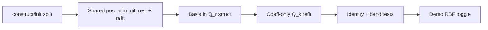

# RBF Mode-Basis Redesign

**Status:** Superseded for bending by [`slab_incompressible_phi_material.md`](slab_incompressible_phi_material.md) (fixed Q_r + div-free φ). Kept for RBF history only.
**Supersedes:** [`docs/stash/rbf-mode-basis-redesign-plan.md`](stash/rbf-mode-basis-redesign-plan.md) (snapshot).

---

## Problem (unchanged)

Variational bulk energy stays **`|∇ΔD|² + λ_gap ΔD²`**. Both embeds must use the **same geometry API** and the **same foot-local sample set**:

```text
ΔD(x) = D(Q_r, x) − D(Q_k, x)
```

Construct/init split fixes the **geometry path** (`init_rest` / `project` both use `get_vec3`). RBF still fails because **Q_r and Q_k use mismatched representations** when each fit independently chooses centers / poly gauge.

### Wrong vs right framing

| Symptom | Wrong fix (band-aids) | Right fix |
|---------|----------------------|-----------|
| ΔD ≠ 0 at rest | Freeze rest centers on live refit only | **Single shared basis** established at Q_r; Q_k refits **coefficients only** |
| Wild bend response | SVD tolerance / skip GD | **Low-order fit** (few RBF + linear) + **two normal constraints** |
| Unstable fits | Homogeneous null-space hacks | Fixed basis + foot/pierce normal gauge (no Tikhonov) |

**Principle:** RBF field is a **smooth deformation prior**, not a per-step interpolant.

---

## Current code (band-aids to replace)

| Location | What it does |
|----------|--------------|
| `local_slab_field_fit.hpp` | `fit_rbf_mls_on_stencil(..., fixed_centers*, fixed_sigma)` |
| `level_set_field_bundle.hpp` | `rbf_field_bundle::fit_Q(..., rest_basis*)`, `fit_field_coeffs_on_stencil(..., rest_basis*)` |
| `shape_field_divergence_strain.hpp` | `refit_live_field` passes `&_Q_rest` to freeze centers |

These **partially** enforce shared centers but leave:

- **Linear** poly (4) + up to **8 spoke-sampled** centers → over-parameterized
- Basis chosen independently when `rest_basis == nullptr` (tests / mistakes)
- `rbf_reg = 1e-10` — **remove**; foot + pierce normals are the regularizer

**Keep:** ring-only hub normals, stack MLS matrices, no energy-tolerance `skip_gd`.

---

## Target representation

```text
D(Q, x) = p_linear(x) + Σ_k w_k φ(‖x − c_k‖ / σ)
```

**Keep RBFs.** Fix the **order / DOF budget**, not the field family.

| Component | Rest (Q_r) | Live (Q_k) |
|-----------|------------|------------|
| Foot frame / hub normals | From block `pos_at` | Same stencil ids |
| RBF centers `c_k` | **Choose once** (3–4 wide modes) | **Copy from Q_r** |
| Width `σ` | `rbf_sigma_scale × avg_edge` | **Copy from Q_r** |
| Linear poly `p` | 4 coeffs (1, x, y, z) | Refit |
| Weights `w_k` | Fit | Refit |

**Lower order** means:

- **Few** RBF modes (3–4 wide Gaussians), not one center per spoke (up to 8)
- **Linear** polynomial tail only
- **Shared basis** at Q_r; Q_k refits coefficients only
- **No Tikhonov** — gauge + conditioning from **two normal rows only** (unlike Darboux/quadric, no per-spoke normal accumulate)

### Regularization (minimal)

Same hub normals as Darboux path (`compute_stencil_ring_normals`), but RBF uses **only**:

| Row | Location | Constraint |
|-----|----------|------------|
| Foot | `x = 0` | `∇f · n_top = 1` (inhomogeneous gauge) |
| Pierce | pierce foot local | `∇f · n_bot = 0` |

Ring spokes contribute **value** samples only: `f(x_i) = 0` (weighted). That plus 3–4 RBF + linear (8 DOF) and the two normals is sufficient — no extra albers-style normal row per spoke, no diagonal `rbf_reg`.

Quadric / Darboux remain separate families (dense normal accumulate at every sample); RBF stays lighter.

### Basis selection at Q_r (sketch)

1. Gather foot-local spoke samples (as today).
2. Pick `n_rbf ∈ {3,4}` centers by **even subsample** of samples (not first-k spokes).
3. Single wide `σ` from `cfg.rbf_sigma_scale * avg_edge_length`.
4. Solve LS (QR): ring `f(x_i)=0` + foot/pierce normal rows; **`rbf_reg = 0`**.

### Live refit

Always:

```cpp
_Q_live = fit_field_coeffs_on_stencil(..., pos_at, cfg, avg, &_Q_rest);
```

After redesign, `_Q_rest.rbf` **stores the basis**; refit is **coefficient-only** by construction (no optional pointer — internal to fit when `frozen_basis` set).

---

## Implementation checklist

### Step 1 — Revert band-aid surface API ✓ (merge with Step 2)

- [ ] Replace `fixed_centers` / `rest_basis` optional params with explicit `const local_rbf_mls_field *frozen_basis` (or `enum fit_mode { establish, refit_coeffs }`)
- [ ] `init_rest`: `establish` mode only
- [ ] `refit_live_field`: always `refit_coeffs` from `_Q_rest.rbf`

### Step 2 — Low-order RBF fit

- [ ] Default `max_rbf_centers = 4` (down from 8)
- [ ] Even subsample center selection (not first-k spokes)
- [ ] Keep `slab_field_rbf_poly_dim = 4` (linear tail)
- [ ] Drop Tikhonov (`rbf_reg = 0`); foot + pierce normals only
- [ ] Basis stored in `Q_r.rbf`; live refit is coeff-only on frozen `{c_k, σ}`

### Step 3 — Tests

| Test | Expect after redesign |
|------|----------------------|
| `shape_field_rbf_refit_matches_Q_rest_at_rest` | Q_live coeffs ≈ Q_rest at same geometry |
| `shape_field_dual_ring_projection_identity_refit_live_rbf` | ‖p − Aq‖ / ‖Aq‖ small at rest |
| `shape_field_rbf_small_perturbation_bounded_energy` | e(ε) ≪ e(large bend); shared centers |
| `shape_field_init_rest_matches_legacy_ctor` | Still passes (Darboux path) |
| `slab_rbf_init_low_valence_no_crash` | Fewer cols (4 RBF + 4 linear = 8) vs sample rows |

### Step 4 — Demo

- [ ] Keep `slab_prism_bending.hpp` default **`field_family = darboux`** until RBF suite green
- [ ] Optional flag to try RBF in demo after tests pass

---

## Dependency graph



**A–B:** Done (Phase 0–4).
**C–F:** This plan.

---

## Files to touch

| File | Change |
|------|--------|
| `local_slab_field_fit.hpp` | Center policy, frozen-basis fit, defaults |
| `level_set_field_bundle.hpp` | Simplify `fit_Q` / `fit_field_coeffs_on_stencil` |
| `shape_field_divergence_strain.hpp` | Always refit from `_Q_rest` basis |
| `slab_prism_tests.hpp` | Tighten / add basis-parity asserts |
| `slab_prism_config.hpp` | Optional: document RBF defaults |

No change to generated bulk energy (`slab_field_energy_generated.hpp`) — RBF uses analytic `field_sample` path in `slab_field_divergence_energy.hpp`.
