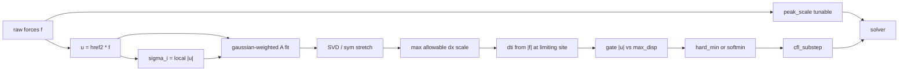

# SVD Neighborhood CFL

## Thesis: statistical elements

We are not trying to beat MPM/FEM on their own grid. We are building a **statistical element**: a Gaussian-weighted local chart on predicted displacement whose SVD/edge rates stand in for “will this neighborhood collapse?”

That is the novel cut relative to per-element CCD / 4D tet inversion:

- **No exact contact root-find** — predict a local motion ellipsoid and read time-to-degeneracy.
- **Cheaper and easier to wire** than continuous collision on every primitive pair; cost is local fits + a gated softmin, not continuous root isolation.
- **Works where you lack a nice mesh** (rods, point-sampled forces) and still upgrades cleanly when you *do* have faces (shell per-face `F` as a hard statistical element).
- Rod edge-closing is the 1D statistical element; neighborhood SVD is the thicker chart when the stencil allows.

Novelty claim to defend in implementation: *displacement-gated, locally bandwidth-scaled Gaussian elements as a CFL oracle* — not a drop-in sound-speed CFL.

## Decisions

1. **Rod first** into `braid_planar_demo`. Shell API deferred.
2. **Predicted displacement** is the field: find max allowable `|dx|` from the local ellipsoid, then back out `dti` from the force at the limiting site.
3. **Aggregation is a config** (`hard_min` vs `softmin`) — trivial enum.
4. **`peak_scale` stays tunable** (force conditioning only; geometry owns `dti`).
5. **Neighborhood weights: Gaussian with local bandwidth** (not global `max|u|`). Harmonic left as a later config option if needed.

## Gaussian bandwidth: local, not global max

Global `σ = max_i |u_i|` is a bad default: one hot contact makes a massive ball at every vertex, so the “local” ellipsoid stops being local and quiet regions inherit contact-scale neighborhoods.

**Use per-site local displacement instead:**

```
u_i = h_ref² f_i
σ_i = max( |u_i|,  max_{j∈N(i)} |u_j|,  σ_floor )
```

with `σ_floor ≈ ε · ℓ_local` (mean adjacent edge length at `i`, or `ε·lavg`).

Why this is better:

- Hot contacts keep a wide kernel where motion is large.
- Quiet segments keep a tight kernel (floored by mesh scale so the 3×3 fit stays well-posed).
- Relative motion `U_j = u_j - u_i` already carries the collapse signal; `σ_i` only chooses who enters the fit.

Optional later config: `sigma_mode = local | global_max` for A/B, default `local`.

## Relation to SOTA Courant / SVD timestepping

Classical and “state of the art” CFL usually assume a **nice mesh or grid**:

| Setting | What you have | Timestep limit |
|--------|----------------|----------------|
| CFD / Cartesian | cell size `Δx`, velocity `u` | `dt < C Δx / \|u\|` |
| Explicit FEM / MPM | element / grid `F = ∂x/∂X`, material sound speed from constitutive law | SVD/`Σ` of `F` → wave speed `c(Σ)` → `dt < C Δx / c` |
| Hyperelastic graphics | per-tet/tri deformation gradient | monitor `det(F)` / `σ_min(F)`; sometimes tangent-stiffness eigenbounds |

Those methods are clean because **`F` and `Δx` are defined by the element**. Shape functions give a real velocity gradient; SVD of `F` is continuum mechanics, not a heuristic.

**How this squares — and where it is novel:**

- SOTA needs an element. We **synthesize a statistical element** from `u = h²f` with local Gaussian bandwidth + displacement gate.
- Same geometry intent as inversion-aware / `σ_min(F)` limits; **weaker** than constitutive sound-speed CFL (projection already stiffens); **easier/faster path** than per-element CCD when you only need a conservative `dti`.
- Rod: 1D statistical element = edge closing; 3×3 SVD is an optional thicker chart (rank-aware).
- Shell later: per-face `F` is a hard elemental instance of the same interface — not a different system.

## Post-estimation gate (tiny-displacement pollution)

**Catch:** tiny local `|u|` does not usually make a *true* small CFL — quiet sites have small rates and large `dti`. The pollution is the opposite failure mode: near-zero `U` + local `σ_floor` + ill-conditioned fits (especially rods: only prev/next → rank-deficient 3×3) invent **phantom compressive eigenvalues**, so garbage-small `s_i` / `dti_i` win the hardmin/softmin and the whole frame crawls.

So after per-site estimates, **only sites that actually move get a vote**:

```
max_disp = max_k |u_k|
gate_i   = (|u_i| >= gate_frac * max_disp)
           and (|u_i| >= u_abs_floor)          // optional absolute floor
```

- If `!gate_i`: discard `dti_i` (treat as +∞ / skip).
- Aggregate only over gated sites.
- If **no** site passes the gate (everything quiet): `dti = dt_max` (take the full residual).

Also gate the edge term on relative closing, not just `|u_i|`:

```
closing_j = max(-(U_j · R̂_j), 0)
use edge/SVD at i only if max_j closing_j >= gate_frac * max_disp
```

Defaults: `gate_frac ≈ 0.05 … 0.1`. Config knobs: `gate_frac`, `u_abs_floor`.

This is the same gotcha as “min over all Courant numbers including idle cells” — idle / noise cells must not set the clock.

## Pipeline



## Core math

Per site `i`, neighbors `j` (rod: prev/next corners):

- `R_j = x_j - x_i`
- `U_j = u_j - u_i` with `u = h_ref² f`
- `σ_i = max(|u_i|, max_j |u_j|, σ_floor)`
- `w_j = exp(-|R_j|² / (2 σ_i²))`

Fit `A` so `A R ≈ U`:

```
C_rr = Σ w R⊗R + ε I
C_ur = Σ w U⊗R
A = C_ur * C_rr⁻¹
```

`S = (A + Aᵀ)/2`. Compressive eigenvalues give a **scale** to singularity of `I + s S` (or edge-collapse under `U`):

```
s_i = cfl_frac / max(-λ_min, ε)     // allowable scale of u
```

Also edge guard on predicted relative displacement:

```
s_edge = cfl_frac * |R| / max(-(U·R̂), ε)
s_i = min(s_i, s_edge…)
```

Convert scale → dt at the limiting site. Because `u = h_ref² f` and physical step uses the same inertia map `dx ≈ dti² f`:

```
dti_i = h_ref * sqrt(s_i)     // since dx = s * u = s * h_ref² f = dti² f
```

(If a site has tiny `|f|`, skip / infinite dt.)

**Gate before aggregate:** keep `dti_i` only if `|u_i| >= gate_frac * max_disp` (and optional absolute floor). See above.

Aggregate gated `dti_i` via config:

- `hard_min` → `min_i dti_i`
- `softmin` → `-τ log Σ exp(-dti_i/τ)`

then `dti = clamp(dti, dt_min, dt_max)`.

## File layout

- New: `include/gaudi/duchamp/modules/cfl_neighborhood.hpp`
  - `cfl_neighborhood_config`: `cfl_frac`, `agg` (`hard_min`|`softmin`), `softmin_tau`, `weight` (`gaussian`; `harmonic` stub), `sigma_mode` (`local` default), `gate_frac`, `u_abs_floor`, `eps`, `dt_max`, `dt_min`
  - shared fit + scale→dt
  - `cfl_estimate_rod_dt(rod, forces, cfg)` only this pass
- `include/gaudi/duchamp/modules/cfl_step.hpp`: peak_scale remains; `dx_max <= 0` means disabled (fix braid ctor overwrite)
- `include/gaudi/duchamp/braid_planar_demo.hpp`: rod geometric estimate in `cfl_substep`; log substeps / dti / limiting scale

## Braid loop

```
while accum < dt_step:
  G = TP.compute()
  dti = cfl_estimate_rod_dt(R, G, neigh_cfg)  // uses href=dt_max
  dti = residual(dti, dt_step, accum)
  Ĝ = peak_scale(G)                           // tunable conditioning
  solver.set_dt(dti); apply Ĝ; solve
  accum += dti
```

## Defaults (braid)

- `peak_scale = 1.0` (tunable)
- `dx_max` off
- `dt_max = dt` (also `h_ref`)
- `cfl_frac ≈ 0.4`
- `agg = softmin`, `softmin_tau` from `~0.05·lavg`
- Gaussian weights, `σ_i` from **local** `|u|` (+ edge-length floor)
- `gate_frac ≈ 0.1` — drop sites with `|u| < gate_frac · max_disp` before aggregate

## Implementation todos

1. ~~Add `cfl_neighborhood.hpp`~~ — done (`include/gaudi/duchamp/modules/cfl_neighborhood.hpp`)
2. ~~Add `cfl_estimate_rod_dt`~~ — done (edge primary + optional SVD + gate + softmin/hardmin)
3. ~~`peak_scale` tunable; `dx_max<=0` off~~ — done in braid ctor
4. ~~Wire into `braid_planar_demo`~~ — done; logs `gated`, `max|u|`, `s_min`

## Out of scope

- Shell estimator / morph wiring
- Barnes–Hut acceleration of the fit
- Full 4D tet CCD
- Harmonic weights (enum reserved, not required to work yet)
